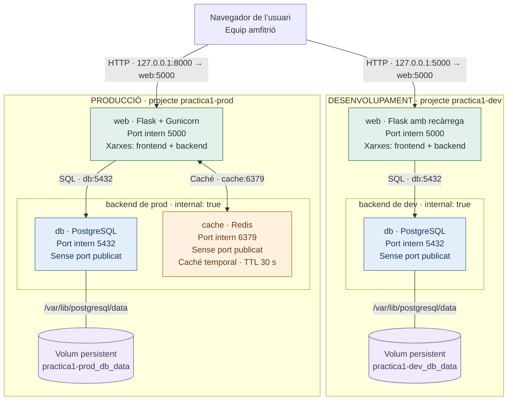

# Pràctica 1: notes amb Flask i Docker Compose

Aplicació per crear i consultar notes, amb dos entorns independents: desenvolupament amb Flask i PostgreSQL, i producció amb Flask sobre Gunicorn, PostgreSQL i Redis.

Aquest README integra el guió de presentació i les explicacions del recorregut. El fil principal segueix la demostració pas a pas: **què dir, què executar i què s'ha de veure**. Les explicacions tècniques s'inclouen al pas corresponent i als apartats de consulta finals.

Les execucions anteriors i les seves dates es documenten a [resultats i evidències](docs/resultados.md). Els resultats esperats d'aquest guió no substitueixen una execució real.

## Com utilitzar aquest document

- [Preparació i arrencada habitual](#preparacio): per executar l'aplicació conservant les dades existents.
- [Guió de presentació](#presentacio): demostració completa, amb neteja inicial opcional que elimina les notes.
- [Arquitectura i entorns](#arquitectura): diagrama i comparació de desenvolupament i producció.
- [Organització del projecte](#organitzacio): responsabilitat de cada carpeta i fitxer.
- [Funcionament de l'aplicació](#funcionament): recorregut d'una nota, API i tractament de les dades.
- [Configuració, seguretat i salut](#configuracio): variables, permisos i healthchecks.
- [Ordres de consulta i diagnòstic](#ordres): automatització i resolució de problemes.
- [Evidències i entrega](#entrega): resultats, ZIP i declaració d'IA.

<a id="preparacio"></a>

## Preparació i arrencada habitual

Cal Docker Engine en execució, Docker Compose v2 o posterior, Bash i Python 3 per als scripts auxiliars. La construcció necessita accés a les imatges i dependències d'Internet. Les demostracions HTTP utilitzen `curl`; `watch` només és necessari per veure els comptadors de Redis contínuament.

Des de la carpeta del projecte:

```bash
./run.sh init
./run.sh up-dev
./run.sh up-prod
```

Obre <http://localhost:5000> per a desenvolupament i <http://localhost:8000> per a producció. Aquests són els ports per defecte; han d'estar lliures o s'han de canviar als `.env`. Aquesta arrencada conserva els volums i les notes existents.

`init` genera `.env.dev` i `.env.prod` amb contrasenyes aleatòries diferents i permisos `600`; no sobreescriu fitxers existents. Les plantilles `.example` contenen marcadors, no credencials operatives. L'aplicació i les dependències s'instal·len dins de Docker.

<a id="presentacio"></a>

## Guió de presentació, des d'un desplegament buit

Durada orientativa: 20–25 minuts, més el temps de construcció i proves. Executa els blocs un a un i explica el resultat abans de continuar. Per mostrar l'aplicació a un usuari, obre breument les dues pàgines; després tanca-les abans de les proves de caché. També tens alternatives amb `curl` per fer la demostració només des del terminal.

La neteja del pas 1 és **opcional i destructiva per a les notes**. Per conservar-les, omet aquest pas i executa `./run.sh init` abans de validar la configuració.

### 0. Presentar l'objectiu i comprovar Docker

**Què dir:** «Presentaré una aplicació de notes amb dos entorns separats. Desenvolupament utilitza Flask i PostgreSQL; producció utilitza Gunicorn, PostgreSQL i Redis. Començaré eliminant el desplegament anterior perquè es vegi tot el procés.»

```bash
cd ~/Escritorio/Projecte1_XXAA
```
o la ubicació del projecte que és tengui i
```bash
docker info --format '{{.ServerVersion}}'
docker compose version
```
Per comprovar que es té instal·lat tant Docker com Docker Compose consultant les versions pertinents que es tenen.
Si Docker no respon, resol el problema abans de començar. Les URLs del guió assumeixen els ports per defecte: 5000 i 8000.

### 1. Esborrar el desplegament anterior

Ara eliminarem els contenidors, les xarxes, els volums amb les notes i les imatges locals de la web dels dos entorns. Conservarem el codi font i la configuració privada. Això se fa per transparència alhora de presentar el projecte.

**Aquest bloc elimina permanentment les notes de dev i prod.** Només afecta els dos projectes de la pràctica.

```bash
./run.sh init
./run.sh compose dev down --volumes --remove-orphans --rmi local
./run.sh compose prod down --volumes --remove-orphans --rmi local
```

`init` assegura que existeixen els fitxers necessaris per executar Compose; si ja existeixen, els conserva. El teu `run.sh` exigeix aquests fitxers fins i tot per executar `down`, i Compose necessita resoldre les variables obligatòries. Si els dos `.env` ja existeixen, `init` és prescindible.

`--volumes` elimina els volums i les notes; `--remove-orphans` elimina contenidors del mateix projecte que ja no apareixen al Compose; `--rmi local` elimina les imatges dels serveis sense etiqueta personalitzada, com la de `web`. El codi i els `.env` es conserven. Les imatges base i la caché de construcció poden continuar a Docker: un desplegament buit no implica que tot Docker estigui buit.

**Demostrar el punt de partida:**

```bash
docker ps -a 
docker network ls
docker volume ls
```

**Què s'ha de veure:** cap recurs d'aquests projectes a les llistes. Si una ordre de neteja falla o queden recursos, revisa l'error abans de continuar.

### 2. Explicar els fitxers que reconstruiran el sistema

Mostra a l'editor, en aquest ordre:

| Fitxer | Què explicar |
| --- | --- |
| `Dockerfile` | Parteix de Python, instal·la dependències, copia l'aplicació i executa amb un usuari sense privilegis. |
| `docker-compose.dev.yml` | Dos serveis, Flask amb recàrrega i codi local muntat de només lectura. |
| `docker-compose.prod.yml` | Tres serveis, Gunicorn i Redis; codi incorporat a la imatge. |
| `.env.dev.example` i `.env.prod.example` | Plantilles de configuració; els fitxers privats contenen les credencials. |
| `db/init.sh` | Inicialitza la base quan el volum és buit i crea l'usuari limitat de l'aplicació. |
| `run.sh` | Selecciona el projecte, el Compose i el fitxer de variables correctes. |

No mostris el contingut dels `.env` privats ni un `docker inspect` complet: contenen credencials.

```bash
./run.sh compose dev config --quiet
./run.sh compose prod config --quiet
```

**Què s'ha de veure:** les ordres acaben sense errors. Aquestes ordres llegeixen els `.env`, substitueixen les variables al Compose i validen la configuració. `--quiet` amaga la configuració resultant: si tot és correcte no mostra res; si hi ha un problema, mostra un error. No creen fitxers, no arrenquen contenidors i no comproven que les contrasenyes funcionin contra PostgreSQL.

### 3. Construir i arrencar desenvolupament

Amb una sola ordre construirem la imatge i arrencarem els serveis de desenvolupament. Una imatge és la plantilla i un contenidor és una instància en execució.»

```bash
./run.sh up-dev
./run.sh status dev
./run.sh db-test dev
```

`up-dev` selecciona `docker-compose.dev.yml`, carrega `.env.dev` i utilitza el projecte `practica1-dev`. Executa `up --build -d --wait --wait-timeout 180`:

| Opció | Què fa |
| --- | --- |
| `up` | Crea els recursos que falten i arrenca els serveis; reutilitza o actualitza els existents segons la configuració. |
| `--build` | Construeix la imatge web, aprofitant capes de construcció quan és possible. PostgreSQL utilitza una imatge oficial. |
| `-d` | Deixa els contenidors en segon pla. |
| `--wait` | Espera que els serveis superin els healthchecks. |
| `--wait-timeout 180` | Limita l'espera a 180 segons; si falla, retorna un error, però no elimina automàticament els contenidors. |

No cal separar construcció i arrencada. Si vols repetir totes les capes expressament, pots substituir `up-dev` per `./run.sh compose dev build --no-cache` i després `./run.sh compose dev up -d --wait --wait-timeout 180`. Aquesta caché de construcció és diferent de Redis i no conserva les notes de PostgreSQL.

**Què s'ha de veure:** `web` i `db` saludables; la consulta SQL retorna `connection_ok = 1`.

`db-test` executa, amb l'usuari de l'aplicació:

```sql
SELECT current_user, current_database(), 1 AS connection_ok;
```

`current_user` mostra l'usuari; `current_database()` mostra la base connectada; `1 AS connection_ok` posa el valor fix `1` en una columna amb aquest nom. Que es retorni la fila demostra connexió, autenticació i execució SQL, però el `1` no és un diagnòstic calculat ni comprova que hi hagi notes.

Obre <http://localhost:5000> i crea la nota `Nota nomes de DEV`, per exemple. Si se preten usar només el terminal, fes aquesta alternativa:

```bash
curl -sS -X POST http://localhost:5000/api/notes -H 'Content-Type: application/json' -d '{"content":"Nota nomes de DEV"}'
curl -sS http://localhost:5000/api/notes
```

**Què explicar:** PostgreSQL connectat, Redis no configurat i dades llegides des de PostgreSQL. El port 5000 de l'ordinador apunta al port 5000 del contenidor web.

### 4. Construir i arrencar producció

```bash
./run.sh up-prod
./run.sh status prod
./run.sh db-test prod
```

`up-prod` fa la mateixa operació d'arrencada, però selecciona `docker-compose.prod.yml`, `.env.prod` i el projecte `practica1-prod`. Executa Gunicorn i incorpora Redis.

Obre <http://localhost:8000> i crea `Nota nomes de PROD`, per exemple. Alternativa només per terminal:

```bash
curl -sS -X POST http://localhost:8000/api/notes -H 'Content-Type: application/json' -d '{"content":"Nota nomes de PROD"}'
curl -sS http://localhost:8000/api/notes
curl -sS http://localhost:5000/api/notes
```

**Què s'ha de veure:** tres serveis saludables: `web`, `db` i `cache`. La nota de DEV no apareix a PROD, ni a la inversa.

Els dos entorns conviuen amb projectes, xarxes i volums diferents. Producció publica el port 8000 de l'ordinador, però la web continua escoltant al port 5000 dins del contenidor

### 5. Explicar les xarxes i el contenidor compartit

```bash
docker network ls
docker network inspect practica1-prod_frontend
docker network inspect practica1-prod_backend
```

**Què s'ha de veure:** `frontend` conté `web`; `backend` conté `web`, `db` i `cache`. L'identificador de `web` coincideix a les dues sortides.

És un sol contenidor web connectat a dues xarxes, amb una IP per xarxa. No són quatre contenidors. La xarxa backend és interna i les dades no publiquen ports. El navegador accedeix a la web gràcies al port publicat; el nom frontend no publica res per si mateix.»

Dins de `web`, `localhost` apunta al mateix contenidor. La web arriba a PostgreSQL amb `db:5432` i a Redis amb `cache:6379`: Docker resol aquests noms a la xarxa del projecte. No cal publicar els ports de les dades. A la inspecció, la IP i l'`EndpointID` poden ser diferents per xarxa, mentre que l'identificador del contenidor és el mateix.

### 6. Demostrar Redis: primera lectura i reutilització

Tanca les pàgines web per evitar lectures simultànies. Executa les consultes seguides, abans que caduqui la caché (TTL = 30 segons per defecte).

```bash
./run.sh cache-stats
```
Se recomana obrir aquest comando en una nova finestra de terminal per tenir major claretat de la situació, tant si s'usa únicament terminal com si s'interactua amb la web.
Com a alternativa, tenim també aquest següent comando:
```bash
./run.sh cache-stats --once
```
La diferència entre els dos comandos és que el primer presenta una visió dinàmica dels cache_hits i cache_misses.
```bash
./run.sh compose prod exec -T cache redis-cli DEL notes:list
```
Emprau aquest comando si se desitja borrar el contingut en caché. D'altra banda, si s'esperen els 30s de TTL, se farà de forma automàtica. Se pot fer servir per accelerar el procés per veure un cache_miss.
```bash
curl -sS http://localhost:8000/api/notes
curl -sS http://localhost:8000/api/notes
./run.sh cache-stats --once
```
Pitjar en el botó de "Consultar notas" per veure el cache_hit o cache_miss si se desitja interactuar amb la web.

**Què s'ha de veure:** primera lectura amb `source=postgresql`, `cache=miss`; segona amb `source=redis`, `cache=hit`. Els comptadors de Redis també augmenten. `DEL` pot retornar 0 o 1, segons si hi havia una còpia.

He eliminat només la còpia de la llista a Redis, no les notes. La primera consulta recupera les dades de PostgreSQL i les desa temporalment a Redis. La segona reutilitza aquesta còpia.

`exec -T cache` executa l'ordre dins del servei Redis sense terminal interactiu; `redis-cli` és el client i `DEL notes:list` elimina només aquesta clau. Retorna `1` si l'ha eliminada o `0` si ja no existia. Les notes originals continuen a PostgreSQL.

`cache-stats --once` consulta `redis-cli INFO stats` i mostra `keyspace_hits` i `keyspace_misses`. Són comptadors globals mantinguts per Redis, independents dels camps que declara Flask al JSON. Sense altres lectures, contrasten el MISS/HIT de les dues peticions. `./run.sh cache-stats` els actualitza cada segon amb `watch`; surt amb `Ctrl+C`.

Per demostrar la invalidació en escriure:

```bash
curl -sS -X POST http://localhost:8000/api/notes -H 'Content-Type: application/json' -d '{"content":"Nota per demostrar invalidacio"}'
curl -sS http://localhost:8000/api/notes
```

**Què s'ha de veure:** la nova nota i una lectura des de PostgreSQL, perquè escriure invalida la còpia anterior.

La còpia caduca segons `CACHE_TTL` (30 segons per defecte), i Redis no té persistència configurada. Els healthchecks continuen fent comprovacions encara que la llista vingui de Redis: la caché redueix les lectures SQL de notes, no tota l'activitat SQL.

`Cache-Control: no-store` impedeix reutilitzar la resposta en cachés HTTP del navegador o intermediaris; no desactiva la caché interna de Redis.

**Límit conegut:** una lectura concurrent amb una escriptura pot desar una còpia antiga després de la invalidació. El TTL en limita la durada; no hi ha consistència estricta ni una transacció distribuïda entre SQL i Redis. Si falla la invalidació, la nota queda guardada i l'API retorna un avís.

### 7. Demostrar persistència eliminant el contenidor de la base

Ara eliminaram el contenidor de PostgreSQL, però conservarem el volum. Comparara, els identificadors i consultarem directament SQL per demostrar que les notes sobreviuen, és a dir, que les dades són persistents.

```bash
docker inspect practica1-prod-db-1 --format '{{.Id}}'
./run.sh compose prod stop db
./run.sh compose prod rm -f db
docker volume ls --filter label=com.docker.compose.project=practica1-prod
./run.sh compose prod up -d --wait --wait-timeout 180 db
docker inspect practica1-prod-db-1 --format '{{.Id}}'
./run.sh compose prod exec -T db sh -c 'PGPASSWORD="$DB_PASSWORD" psql -h 127.0.0.1 -U "$DB_USER" -d "$POSTGRES_DB" -c "SELECT id, content FROM notes ORDER BY id;"'
```

**Què s'ha de veure:** identificador nou del contenidor i les notes anteriors presents a SQL. La consulta directa evita confondre persistència amb una còpia a Redis.

Les dades viuen al volum. Si hagués eliminat també el volum amb `down --volumes`, les hauria perdut, com a la neteja inicial

Compose torna a muntar el mateix volum a `/var/lib/postgresql/data`. Els volums `practica1-dev_db_data` i `practica1-prod_db_data` són independents encara que els YAML utilitzin el nom `db_data`. Els identificadors de notes també són locals a cada base: una nota amb el mateix número als dos entorns no implica que sigui compartida. Un volum no substitueix una còpia de seguretat ni protegeix contra l'eliminació del mateix volum.

### 8. Provocar fallades i recuperar els serveis

#### Redis deixa de funcionar

```bash
./run.sh compose prod stop cache
curl -i http://localhost:8000/status
curl -sS http://localhost:8000/api/notes
```

**Resultat esperat:** `/status` retorna 503, però la llista funciona des de PostgreSQL amb `cache=unavailable`.

```bash
./run.sh compose prod start cache
./run.sh compose prod up -d --wait --wait-timeout 180
curl -i http://localhost:8000/status
```

**Resultat esperat:** recuperació i HTTP 200.

#### PostgreSQL deixa de funcionar

Buida primer la còpia de Redis per evitar que emmascari la fallada de lectura:

```bash
./run.sh compose prod exec -T cache redis-cli DEL notes:list
./run.sh compose prod stop db
curl -i http://localhost:8000/status
curl -i http://localhost:8000/api/notes
```

**Resultat esperat:** HTTP 503 a les dues consultes.

```bash
./run.sh compose prod start db
./run.sh compose prod up -d --wait --wait-timeout 180
curl -i http://localhost:8000/status
```

El healthcheck detecta el problema; no reinicia automàticament un contenidor només perquè sigui unhealthy. El seu estat pot trigar més a canviar que la resposta de l'API perquè exigeix diversos errors.

Si PostgreSQL cau mentre Redis encara conserva una còpia, la llista podria continuar apareixent, però `/status` detectaria el problema perquè comprova les connexions independentment. Per això hem buidat la caché abans de la demostració de fallada SQL.

La pàgina torna a consultar l'estat cinc segons després de cada comprovació i detecta la recuperació sense recàrrega manual. Docker té els seus propis intervals i reintents.

### 9. Executar les proves i mostrar l'estat final

Amb les pàgines tancades i sense altres consultes simultànies:

```bash
./run.sh unit dev
./run.sh test dev
./run.sh test prod
./run.sh verify dev
./run.sh verify prod
./run.sh status dev
./run.sh status prod
```

| Ordre | Què comprova i què modifica |
| --- | --- |
| `unit dev` | Executa les 14 proves de `tests/test_app.py` en un contenidor temporal amb la imatge de dev. Simula PostgreSQL i Redis per provar validació, caché, errors i escriptures. No modifica les notes reals i elimina el contenidor temporal en acabar. |
| `test dev` | Executa `scripts/smoke.py` dins de la web en marxa. Comprova `/status`, crea i llegeix una nota real a PostgreSQL i confirma que Redis no està configurat. |
| `test prod` | Fa les comprovacions HTTP a producció, crea una nota i verifica una primera lectura de PostgreSQL amb MISS i una segona de Redis amb HIT. |
| `verify dev` | Executa `scripts/verify.py`: comprova xarxes, ports i healthchecks; crea una nota, atura PostgreSQL, comprova el 503, elimina i recrea el contenidor conservant el volum i verifica la nota directament amb SQL. |
| `verify prod` | Repeteix la persistència i la fallada SQL; afegeix MISS/HIT, aturada de Redis, detecció del problema i lectura alternativa de PostgreSQL, seguida de recuperació. |
| `status dev` / `status prod` | Executa `docker compose ps -a` per mostrar estat, salut i ports. No modifica els serveis ni executa proves noves. |

`unit dev` inclou també comportaments de producció simulats; `./run.sh unit prod` permet repetir la mateixa suite dins de la imatge de producció. `test` i `verify` deixen notes de prova guardades. `verify` intenta recuperar les dependències en acabar, també si falla una asserció.

**Què explicar:** les unitàries comproven el codi amb dependències simulades; les proves HTTP i d'integració comproven serveis reals. Mostra els resultats reals: si una prova falla, no la presentis com a superada. Pots consultar `./run.sh logs dev` o `./run.sh logs prod` per diagnosticar-la.

**Estat final esperat:** dos contenidors saludables a dev i tres a prod, quatre xarxes i dos volums de dades separats.

### 10. Preparar l'entrega i tancar la presentació

```bash
./run.sh package
```

Es genera `dist/practica1.zip`, sense credencials privades.

**Frase final:** «S'ha reconstruït els dos entorns des d'un desplegament buit i s'ha mostrat l'aïllament, les connexions, la caché, la persistència i la recuperació davant de fallades.»

<a id="arquitectura"></a>

## Arquitectura i diferències entre entorns



Hi ha cinc contenidors (dos a dev i tres a prod), quatre xarxes i dos volums de dades. La web pertany a `frontend` i `backend`; PostgreSQL i Redis només a `backend`, marcada `internal: true`.

| Aspecte | Desenvolupament | Producció |
| --- | --- | --- |
| Compose | `docker-compose.dev.yml` | `docker-compose.prod.yml` |
| Variables | `.env.dev` | `.env.prod` |
| Projecte | `practica1-dev` | `practica1-prod` |
| Servidor web | Flask amb recàrrega, sense depurador interactiu | Gunicorn, 2 processos i 2 fils per procés |
| Codi | Muntatge local de només lectura | Còpia dins de la imatge |
| Caché | Desactivada | Redis autenticat, TTL de 30 s per defecte |
| Reinici | Manual | `unless-stopped` davant la sortida del procés |
| Dades | Volum de dev | Volum separat de prod |
| Port publicat per defecte | `127.0.0.1:5000` | `127.0.0.1:8000` |

La publicació utilitza `127.0.0.1` per a accés local. `BIND_IP=0.0.0.0` permetria accés des d'altres equips si la xarxa i el tallafoc ho permeten. Només es publica la web. `prod` és una simulació acadèmica: no inclou autenticació d'usuaris ni TLS per oferir un servei públic real.

<a id="organitzacio"></a>

## Organització del projecte

| Fitxer o carpeta | Responsabilitat |
| --- | --- |
| `app/__init__.py` | Factoria Flask `create_app()`, configuració, connexions, rutes i caché. |
| `app/templates/index.html` | Estructura HTML de la pàgina. |
| `app/static/app.js` | Formulari, peticions a l'API i actualització de les connexions. |
| `app/static/style.css` | Presentació visual adaptable a mòbil. |
| `db/init.sh` | Creació de la taula i de l'usuari SQL limitat quan el volum és buit. No conté les dades guardades. |
| `Dockerfile` | Construcció de la imatge web i execució sense privilegis. |
| `docker-compose.*.yml` | Serveis, xarxes, volums, ports i healthchecks de cada entorn. |
| `.env.dev` / `.env.prod` | Configuració privada; no es publica ni es distribueix. |
| `.env.*.example` | Plantilles a partir de les quals es genera la configuració privada. |
| `requirements.txt` | Dependències Python. |
| `run.sh` / `Makefile` | Ordres d'automatització i dreceres equivalents. |
| `scripts/init_env.py` | Generació dels `.env` sense sobreescriure'ls. |
| `scripts/smoke.py` / `scripts/verify.py` | Proves HTTP i d'integració amb serveis reals. |
| `scripts/package.py` | Generació de `dist/practica1.zip` sense secrets. |
| `tests/test_app.py` | Proves unitàries amb dependències simulades. |
| `docs/resultados.md` / `docs/evidencias/` | Resultats i evidències datats. |
| `.gitignore` / `.dockerignore` | Exclusions de Git i del context de construcció, respectivament. |
| `.venv/` | Entorn Python local opcional; Docker no el necessita. |

El Dockerfile parteix de Python 3.13, instal·la les dependències, copia `app/` i selecciona l'usuari 10001. Copia les dependències abans del codi per reutilitzar aquesta capa si només canvia Python, HTML o JavaScript. En desenvolupament Compose substitueix Gunicorn per Flask amb recàrrega.

A `run.sh`, el bloc `case` selecciona l'acció i la funció `compose()` prepara `--project-name`, `--env-file` i `-f`. Quan escrius `./run.sh compose dev config --quiet`, el script passa `config --quiet` a Docker Compose: la validació la implementa Compose.

<a id="funcionament"></a>

## Funcionament de l'aplicació i recorregut d'una nota

1. El navegador demana `/`; Flask retorna l'HTML i el navegador carrega JavaScript i CSS.
2. L'usuari escriu una nota i prem Guardar. JavaScript envia `POST /api/notes` amb JSON, per exemple `{"content":"La meva nota"}`.
3. Flask valida que el contingut sigui text d'entre 1 i 500 caràcters.
4. Psycopg connecta amb `db` amb l'usuari limitat de l'aplicació i executa una inserció amb paràmetres, sense concatenar el text a l'SQL.
5. Si l'operació acaba correctament, la transacció es confirma; si hi ha una excepció, es reverteix. Cada operació obre i tanca la connexió.
6. PostgreSQL conserva la nota al volum. A producció Flask intenta eliminar `notes:list` de Redis per invalidar la llista anterior.
7. L'API retorna HTTP 201 i la nota. El navegador mostra el resultat i torna a consultar la llista.

La taula `notes` conté identificador, contingut i data. El navegador mostra el text amb `textContent`, sense interpretar-lo com a HTML. Si la xarxa falla després de confirmar una escriptura, la nota pot haver quedat guardada encara que no arribi la resposta: cal consultar la llista abans de repetir-la.

| Mètode i ruta | Resultat |
| --- | --- |
| `GET /` | HTML, fins i tot si les dependències estan caigudes. |
| `GET /status` | Connexions en JSON: 200 si tot respon o 503 si falla una dependència configurada. |
| `GET /api/notes` | Fins a 100 notes recents, origen i estat de la caché. |
| `POST /api/notes` | 201 si es desa, 400 si el contingut és invàlid o 503 si falla PostgreSQL. |

Les rutes formen l'API pròpia de l'aplicació: no són carpetes ni APIs externes. `curl` és un client HTTP; amb `-i` mostra capçaleres i cos de la resposta.

Flask construeix el JSON amb `jsonify()`. Abans d'enviar-lo, `response_headers()` aplica `ascii_text()` recursivament: normalitza els textos a ASCII, elimina accents i omet símbols sense representació. Per exemple, `Caché` es mostra com `Cache`. PostgreSQL i Redis conserven els originals. És una transformació de presentació amb pèrdua de caràcters, no una mesura de seguretat.

<a id="configuracio"></a>

## Configuració, seguretat i comprovacions de salut

| Variable | Ús |
| --- | --- |
| `WEB_PORT`, `BIND_IP` | Publicació de la web. |
| `POSTGRES_USER`, `POSTGRES_PASSWORD` | Administració i inicialització de PostgreSQL. |
| `DB_NAME`, `DB_USER`, `DB_PASSWORD` | Connexió limitada de l'aplicació. |
| `REDIS_PASSWORD` | Autenticació de Redis a producció. |
| `CACHE_TTL` | Caducitat de la còpia, en segons i major que zero. |

`--env-file` carrega variables per a Compose; els blocs `environment` passen a cada servei les que necessita. La web no rep la contrasenya d'administració de PostgreSQL. En YAML, `$$DB_PASSWORD` evita que Compose substitueixi la variable a l'ordinador: el shell del contenidor la resol quan executa l'ordre.

La imatge oficial de PostgreSQL executa `db/init.sh` només sobre un volum buit. Crea la taula i un usuari amb permisos de lectura i inserció, sense superusuari ni permís per esborrar notes. Canviar les contrasenyes als `.env` després no modifica les del volum existent: s'han de canviar els rols per SQL.

Les credencials estan excloses de Git, del context de construcció i del ZIP. La web s'executa com UID 10001, amb sistema de fitxers de només lectura i `/tmp` temporal. La web i Redis tenen les capacitats Linux retirades i `no-new-privileges`. PostgreSQL conserva l'entrada oficial per preparar permisos i executar amb el seu usuari. No es munta el socket Docker; les consultes SQL són parametritzades, la mida de petició està limitada i els errors no exposen dades de connexió.

Qui administra Docker pot inspeccionar les variables. No publiquis sortides completes de `docker compose config` o `docker inspect`; utilitza `config --quiet` o formats que seleccionin només les dades necessàries.

| Servei | Healthcheck | Interval / timeout / reintents |
| --- | --- | --- |
| PostgreSQL | SQL sobre `notes` per TCP amb l'usuari de l'aplicació. | 5 s / 3 s / 5 |
| Redis | `redis-cli ping` autenticat; espera `PONG`. | 5 s / 3 s / 5 |
| Web | HTTP a `/status`; espera 200. | 10 s / 9 s / 3 |

`depends_on: condition: service_healthy` espera les dependències a l'arrencada. Durant l'execució, l'aplicació gestiona les fallades amb límits de temps. `/status` comprova les connexions; no llegeix l'estat intern de Docker. `restart: unless-stopped` actua quan surt el procés, no només perquè el healthcheck falli.

<a id="ordres"></a>

## Ordres de consulta i diagnòstic

| Ordre | Equivalent amb Make | Funció |
| --- | --- | --- |
| `./run.sh init` | `make init` | Generar configuració. |
| `./run.sh build-dev` / `build-prod` | `make build-dev` / `make build-prod` | Construir la imatge sense arrencar els serveis. |
| `./run.sh up-dev` / `up-prod` | `make up-dev` / `make up-prod` | Construir i arrencar. |
| `./run.sh down dev` / `down prod` | `make down` / `make down ENV=prod` | Eliminar contenidors i xarxes conservant volums. |
| `./run.sh status prod` | `make status ENV=prod` | Mostrar l'estat. |
| `./run.sh logs dev` | `make logs` | Mostrar els darrers logs. |
| `./run.sh test prod` | `make test ENV=prod` | Proves HTTP bàsiques. |
| `./run.sh verify prod` | `make verify ENV=prod` | Persistència i fallades reals. |
| `./run.sh unit dev` | `make unit` | Proves unitàries dins de la imatge. |
| `./run.sh cache-stats --once` | — | Consultar comptadors de Redis. |
| `./run.sh db-test prod` | — | Comprovar connexió SQL. |
| `./run.sh package` | `make package` | Crear el ZIP sense secrets. |


<a id="entrega"></a>

## Evidències, entrega i declaració d'IA

Registra les execucions reals a [docs/resultados.md](docs/resultados.md), amb data.

Declaració d'IA:

- Eina: OpenAI Codex, aplicació d'escriptori, assistent basat en GPT-6 Astra.
- Finalitat: interpretar requisits, explicar conceptes i preparar implementació, proves i documentació.
- Parts assistides: Flask, Dockerfile, Compose, scripts, proves unitàries, guió i README.
- Validació: proves unitàries i proves reals de Docker descrites als resultats, amb captures i sortides d'ordres. L'alumne ha de comprendre el codi i poder reproduir les comprovacions.

## Referències tècniques

- [Docker: arrencada i dependències saludables](https://docs.docker.com/compose/how-tos/startup-order/).
- [Docker: xarxes bridge i noms DNS](https://docs.docker.com/engine/network/drivers/bridge/).
- [Docker: accés a Linux](https://docs.docker.com/engine/install/linux-postinstall/).
- [Flask: desplegament de producció](https://flask.palletsprojects.com/en/stable/deploying/).
- [PostgreSQL: imatge oficial i inicialització](https://hub.docker.com/_/postgres).
- [Psycopg: transaccions i paràmetres](https://www.psycopg.org/psycopg3/docs/basic/usage.html).
- [Redis: client Python](https://redis.io/docs/latest/develop/clients/redis-py/).
- [Redis: Redis CLI](https://redis.io/docs/latest/commands/info/)
