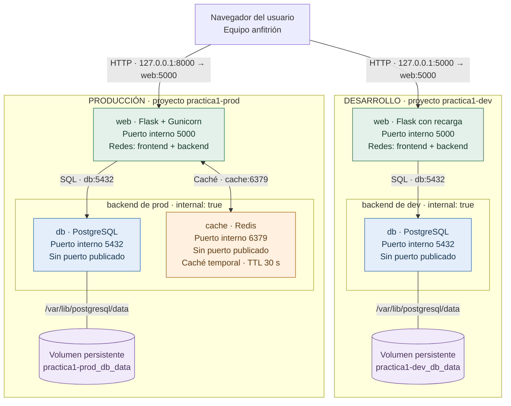

# Práctica 1: notas con Flask y Docker Compose

Servicio web desplegable en desarrollo (Flask y PostgreSQL) y producción (Flask con Gunicorn, PostgreSQL y Redis). Permite crear notas, consultar su origen y observar las conexiones.

**Verificación:** las ejecuciones y sus fechas se documentan por separado para distinguir las pruebas actuales de las evidencias históricas. Véase [resultados y evidencias](docs/resultados.md) y el [recorrido explicado](docs/recorrido-explicado.md).

## 1. Instalación y ejecución

Requisitos: Docker Engine en ejecución, Docker Compose v2 o posterior, Bash y Python 3 para los scripts auxiliares. Acceso a Internet durante la construcción. Puertos 5000 (dev) y 8000 (prod) libres, o modificados en los archivos `.env`. `make` es opcional. Las consultas HTTP de los ejemplos usan `curl`; el seguimiento continuo de Redis requiere `watch`.

Desde la raíz del proyecto:

```bash
docker info --format '{{.ServerVersion}}'
docker compose version
./run.sh init
./run.sh up-dev
./run.sh status dev
./run.sh db-test dev
./run.sh test dev
```

Abrir <http://localhost:5000>. Crear una nota y consultar la lista. En dev el origen será PostgreSQL; Redis aparecerá como no configurado.

`init` genera `.env.dev` y `.env.prod` con contraseñas aleatorias diferentes y permisos `600`; no sobrescribe archivos existentes. Las plantillas `.example` contienen marcadores, no credenciales operativas. La aplicación y sus dependencias se instalan dentro de Docker.

Para producción:

```bash
./run.sh up-prod
./run.sh status prod
./run.sh db-test prod
./run.sh test prod
```

Abrir <http://localhost:8000>. Ambos entornos pueden funcionar a la vez: usan los proyectos Compose `practica1-dev` y `practica1-prod`, con redes y volúmenes separados.

### Error de permisos en Docker

Diagnosticar en la terminal habitual:

```bash
id
ls -l /var/run/docker.sock
sudo docker info --format '{{.ServerVersion}}'
```

Si funciona con `sudo` y el socket pertenece al grupo `docker`, el administrador puede añadir al usuario mediante `sudo usermod -aG docker "$USER"`. Después hay que cerrar la sesión gráfica e iniciarla de nuevo, también reiniciando aplicaciones que conservaran los grupos anteriores. Verificar `docker info` sin `sudo`.

El grupo `docker` concede capacidades equivalentes a administración del equipo. Si el socket tiene otro propietario o tampoco funciona con `sudo`, revisar la instalación antes de cambiar permisos. No usar `chmod 666` para permitir acceso a todos.

## 2. Arquitectura y entornos



El código Mermaid de este bloque es la definición editable del diagrama. Hay cinco contenedores (dos en dev y tres en prod) y cuatro redes (frontend y backend independientes para cada entorno).

La web pertenece a ambas redes. PostgreSQL y Redis solo pertenecen a `backend`, marcada `internal: true`, y no publican puertos. El acceso desde el anfitrión se habilita mediante los puertos publicados de la web; el nombre `frontend` por sí solo no publica servicios. Docker resuelve los nombres `db` y `cache` dentro de sus redes.

La publicación usa `127.0.0.1` por defecto para acceso local. `BIND_IP=0.0.0.0` permitiría acceso desde otros equipos si lo permiten la red y el cortafuegos. Solo se publica la web.

| Aspecto | Desarrollo | Producción |
| --- | --- | --- |
| Orquestación | `docker-compose.dev.yml` | `docker-compose.prod.yml` |
| Variables | `.env.dev` | `.env.prod` |
| Servidor | Flask con recarga, sin depurador interactivo | Gunicorn, 2 procesos y 2 hilos por proceso |
| Código | Montaje local de solo lectura | Copia dentro de la imagen |
| Caché | Desactivada | Redis autenticado, TTL de 30 s |
| Reinicio | Manual | `unless-stopped` ante salida del proceso |
| Datos | Volumen dev | Volumen separado de prod |

`prod` es una simulación académica; no incluye autenticación de usuarios ni TLS para ofrecer un servicio público real.

## 3. Archivos y funcionamiento de Flask

| Archivo | Responsabilidad |
| --- | --- |
| `app/__init__.py` | Factoría Flask, conexiones, rutas y caché |
| `app/templates/index.html` | Estructura HTML |
| `app/static/app.js` | Formulario, consultas y actualización de conexiones |
| `app/static/style.css` | Presentación adaptable a móvil |
| `Dockerfile` | Imagen Python y ejecución sin privilegios |
| `db/init.sh` | Creación de tabla y usuario limitado |
| `docker-compose.*.yml` | Servicios, redes, volúmenes y healthchecks |
| `run.sh` / `Makefile` | Automatización |
| `scripts/` | Configuración, pruebas reales y empaquetado |
| `tests/test_app.py` | Pruebas unitarias con dependencias simuladas |

`create_app()` construye la aplicación y carga variables del entorno. La factoría también permite crear aplicaciones con configuración controlada para las pruebas.

| Método y ruta | Resultado |
| --- | --- |
| `GET /` | HTML, incluso si las dependencias están caídas |
| `GET /status` | Conexiones en JSON; 200 si todo responde o 503 si falla una dependencia configurada |
| `GET /api/notes` | Hasta 100 notas recientes, origen y estado de caché |
| `POST /api/notes` | JSON `{"content":"texto"}`; 201 al guardar, 400 si es inválido o 503 si falla PostgreSQL |

Las rutas `/api/notes` y `/status` forman la API propia que consume el JavaScript del navegador; no son carpetas ni APIs externas.

Antes de enviar una respuesta JSON, `ascii_text()` normaliza los textos a ASCII: `Caché` pasa a `Cache` y `mañana` a `manana`. Los símbolos sin representación ASCII se omiten. Esto también afecta a lo que muestra el navegador; PostgreSQL y Redis conservan los textos originales. Es una transformación de presentación con pérdida de caracteres, no una medida de seguridad.

La tabla `notes` contiene identificador, contenido de 1 a 500 caracteres y fecha. Cada operación abre y cierra su conexión SQL. El contexto `with` confirma la transacción si termina correctamente y la revierte ante una excepción.

La inserción usa parámetros (`VALUES (%s)` y una tupla independiente). El texto no se concatena al SQL. El navegador lo muestra con `textContent`, sin interpretarlo como HTML.

La imagen oficial de PostgreSQL ejecuta `db/init.sh` cuando el volumen está vacío. Crea tabla y usuario con permisos de lectura e inserción, sin superusuario. Cambiar `.env` posteriormente no actualiza las contraseñas guardadas en el volumen: deben modificarse los roles mediante SQL.

## 4. Caché y comportamiento ante fallos

1. En prod, la web busca `notes:list` en Redis.
2. Si existe, devuelve `source=redis`, `cache=hit` sin consultar la lista en PostgreSQL.
3. Si no existe, consulta SQL, guarda el resultado con `SETEX` y devuelve `source=postgresql`, `cache=miss`.
4. Tras confirmar una inserción, elimina la clave para que la siguiente lectura incluya la nota nueva.
5. Si Redis falla, intenta leer PostgreSQL y devuelve `cache=unavailable`.

Para observarlo, crear una nota y consultar dos veces antes del TTL. La lectura automática tras guardar puede ser la primera: observar su origen. Ejecutar los scripts de prueba sin otras consultas simultáneas.

Redis conserva copias desechables, sin persistencia. PostgreSQL es la fuente de datos. Si PostgreSQL cae y Redis aún tiene una copia, la lista puede mostrarse, pero `/status` indicará el fallo porque realiza comprobaciones independientes.

Para observar los aciertos y fallos registrados por el propio Redis, con producción arrancada:

```bash
./run.sh cache-stats
```

Actualiza `keyspace_hits` y `keyspace_misses` cada segundo; salir con `Ctrl+C`. Para una sola consulta, usar `./run.sh cache-stats --once`. Requiere `watch` para el seguimiento continuo. Son contadores acumulados de toda la instancia de Redis: cerrar la página web y evitar otras consultas durante la demostración. Desde otra terminal, ejecutar dos veces seguidas `curl -s http://localhost:8000/api/notes`; la segunda debería registrar un acierto antes de que caduque la copia. La medición procede de Redis, independientemente de los campos del JSON que devuelve Flask.

`Cache-Control: no-store` impide almacenar la respuesta en cachés HTTP del navegador o de intermediarios. No desactiva Redis: es una caché interna del servidor. Los campos `cache` y `source` los genera Flask; los contadores de `INFO stats` los mantiene Redis. Este proyecto no implementa caché HTTP reutilizable.

**Límite conocido:** la invalidación sencilla no garantiza consistencia estricta entre peticiones concurrentes. Una lectura iniciada antes de una escritura puede guardar después una copia anterior; el TTL limita su duración. Si falla la invalidación, la nota permanece guardada y la API devuelve un aviso. Esta demostración utiliza consistencia eventual.

## 5. Healthchecks

| Servicio | Comprobación | Intervalo / timeout / reintentos |
| --- | --- | --- |
| PostgreSQL | SQL sobre `notes` por TCP con el usuario de la aplicación | 5 s / 3 s / 5 |
| Redis | `redis-cli ping` autenticado; espera `PONG` | 5 s / 3 s / 5 |
| Web | HTTP a `/status`; espera código 200 | 10 s / 9 s / 3 |

`depends_on: condition: service_healthy` espera a las dependencias al arrancar. La aplicación sigue gestionando fallos durante la ejecución, con límites de tiempo de conexión y consulta.

El navegador consulta de nuevo 5 segundos después de cada comprobación. `/status` muestra el resultado actual; Docker cambia a `unhealthy` tras acumular los fallos configurados, por lo que puede haber un desfase. El endpoint no lee el estado interno de Docker ni necesita su socket.

`restart: unless-stopped` actúa al salir el proceso. Un healthcheck fallido por sí solo no reinicia el contenedor.

## 6. Variables y seguridad

| Variable | Uso |
| --- | --- |
| `WEB_PORT`, `BIND_IP` | Publicación de la web |
| `POSTGRES_USER`, `POSTGRES_PASSWORD` | Administración e inicialización |
| `DB_NAME`, `DB_USER`, `DB_PASSWORD` | Conexión limitada de la web |
| `REDIS_PASSWORD` | Autenticación Redis en prod |
| `CACHE_TTL` | Caducidad en segundos, mayor que cero |

`--env-file` carga la configuración para Compose; los bloques `environment` pasan solo las variables necesarias a cada servicio. La web no recibe la contraseña del administrador de PostgreSQL.

- Secretos reales excluidos de Git, del contexto de construcción y del ZIP; archivos `.env` con permisos `600`.
- Web como UID 10001, sistema de archivos de solo lectura y `/tmp` temporal.
- Web y Redis sin capacidades Linux y con `no-new-privileges`.
- PostgreSQL conserva su entrada oficial para preparar permisos y ejecutar con su usuario propio.
- Montajes de código dev e inicialización de solo lectura.
- Sin puertos publicados para PostgreSQL/Redis ni socket Docker montado.
- Consultas parametrizadas, tamaño de petición limitado y errores sin datos de conexión.

Quien administra Docker puede inspeccionar variables. No publicar salidas completas de `docker compose config` o `docker inspect`: pueden contener secretos. Para validar, usar `config --quiet`.

## 7. Automatización

| Script | Makefile equivalente | Función |
| --- | --- | --- |
| `./run.sh init` | `make init` | Generar configuración |
| `./run.sh build-dev` | `make build-dev` | Construir imagen dev |
| `./run.sh build-prod` | `make build-prod` | Construir imagen prod |
| `./run.sh up-dev` | `make up-dev` | Construir y arrancar dev |
| `./run.sh up-prod` | `make up-prod` | Construir y arrancar prod |
| `./run.sh down dev` | `make down` | Eliminar contenedores/redes dev |
| `./run.sh down prod` | `make down ENV=prod` | Eliminar contenedores/redes prod |
| `./run.sh status prod` | `make status ENV=prod` | Mostrar estado |
| `./run.sh logs dev` | `make logs` | Últimos logs |
| `./run.sh test prod` | `make test ENV=prod` | Pruebas HTTP básicas |
| `./run.sh verify prod` | `make verify ENV=prod` | Persistencia y caídas reales |
| `./run.sh unit dev` | `make unit` | Pruebas unitarias en una imagen ya construida |
| `./run.sh cache-stats` | — | Contadores de Redis cada segundo; `--once` para una consulta |
| `./run.sh db-test prod` | — | Consulta SQL con el usuario de la aplicación |
| `./run.sh package` | `make package` | ZIP sin secretos |

`down` conserva los volúmenes. **No usar `down -v` para probar persistencia**: elimina los volúmenes y sus datos.

## 8. Pruebas y evidencias

Validación previa sin motor Docker:

```bash
./run.sh compose dev config --quiet
./run.sh compose prod config --quiet
bash -n run.sh
sh -n db/init.sh
```

Con ambos entornos arrancados y sin otras peticiones simultáneas:

```bash
./run.sh test dev
./run.sh verify dev
./run.sh test prod
./run.sh verify prod
```

`verify` crea una nota, detiene PostgreSQL y comprueba el 503 de `/status`. Elimina el contenedor sin borrar el volumen, lo recrea y consulta la nota **directamente por SQL**, para evitar que Redis falsee la persistencia. En prod también comprueba acierto de caché, caída de Redis y lectura alternativa desde PostgreSQL. Intenta recuperar las dependencias al finalizar, incluso ante una aserción fallida.

Las pruebas añaden notas y provocan interrupciones temporales. Ejecutarlas en los entornos locales de esta práctica.

Evidencias para la memoria:

1. Dev con PostgreSQL conectado y Redis no configurado.
2. Prod con ambos conectados y origen Redis en una lectura.
3. Salidas de `status`, `db-test`, `test` y `verify`.
4. Interfaz tras `./run.sh compose prod stop cache`; recuperar con `./run.sh compose prod start cache`.
5. Repetir caída y recuperación con `db`.
6. Desde el anfitrión: `curl -i http://localhost:5000/status` y `curl -i http://localhost:8000/status`.
7. Crear notas distintas en ambos entornos y comprobar que no se mezclan.

Registrar resultados reales en [docs/resultados.md](docs/resultados.md).

Pruebas unitarias locales opcionales, con Python y soporte para entornos virtuales:

```bash
python3 -m venv .venv
.venv/bin/python -m pip install -r requirements.txt
.venv/bin/python -m unittest discover -s tests -v
```

Simulan PostgreSQL y Redis; no acreditan redes ni persistencia reales de Docker.

## 9. Entrega y declaración de IA

La entrega local incluye código, configuración de ejemplo, instrucciones y evidencias. El ZIP se genera con el comando siguiente. La publicación en GitHub y la subida al campus son pasos externos que debe realizar el alumno; generar el ZIP no acredita esas acciones.

`./run.sh package` genera `dist/practica1.zip` con código, plantillas y documentación. Al descomprimir, `./run.sh init` genera nuevas credenciales. Revisar `git status` antes de publicar: los `.env` privados no deben aparecer.

Declaración de IA:

- Herramienta: OpenAI Codex (aplicación de escritorio), asistente basado en GPT-6 según la identificación disponible en la sesión. No se dispone del número de compilación de la aplicación.
- Finalidad: interpretar requisitos, explicar conceptos, preparar implementación y pruebas.
- Partes asistidas: Flask, Dockerfile, Compose, scripts, pruebas unitarias, guía y README.
- Validación: pruebas unitarias y pruebas reales de Docker descritas en `docs/resultados.md`, con capturas y salidas de comandos. El alumno debe comprender el código y poder reproducir las comprobaciones para su defensa.

## 10. Referencias técnicas

- [Docker: arranque y dependencias saludables](https://docs.docker.com/compose/how-tos/startup-order/).
- [Docker: redes bridge y nombres DNS](https://docs.docker.com/engine/network/drivers/bridge/).
- [Docker: acceso en Linux](https://docs.docker.com/engine/install/linux-postinstall/).
- [Flask: despliegue de producción](https://flask.palletsprojects.com/en/stable/deploying/).
- [PostgreSQL: imagen oficial e inicialización](https://hub.docker.com/_/postgres).
- [Psycopg: transacciones y parámetros](https://www.psycopg.org/psycopg3/docs/basic/usage.html).
- [Redis: cliente Python](https://redis.io/docs/latest/develop/clients/redis-py/).

El [recorrido explicado](docs/recorrido-explicado.md) reúne los conceptos y el guion de demostración. Los [resultados](docs/resultados.md) enlazan las evidencias con su fecha.
