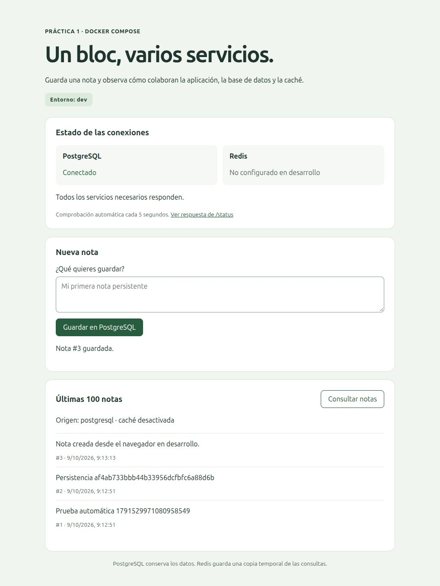
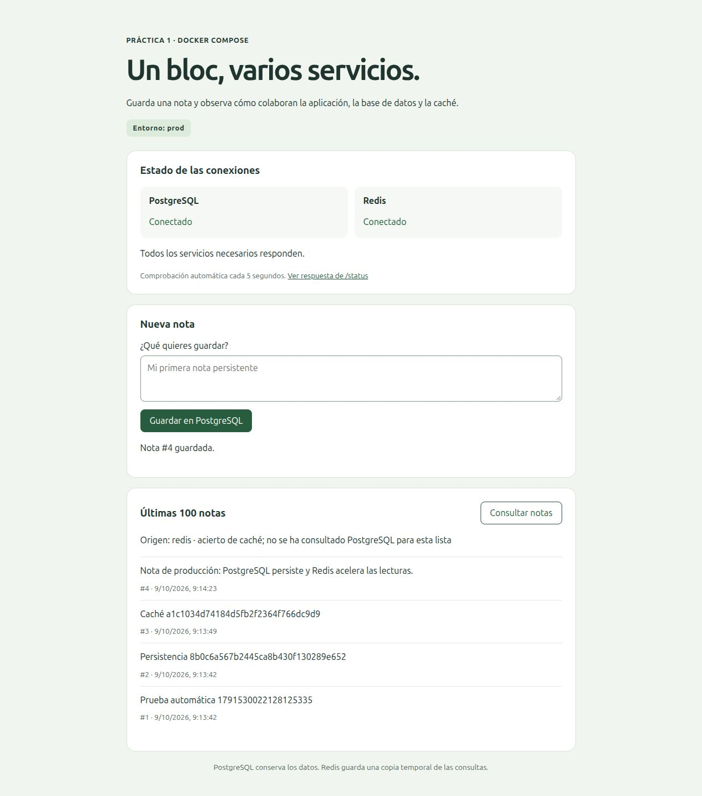
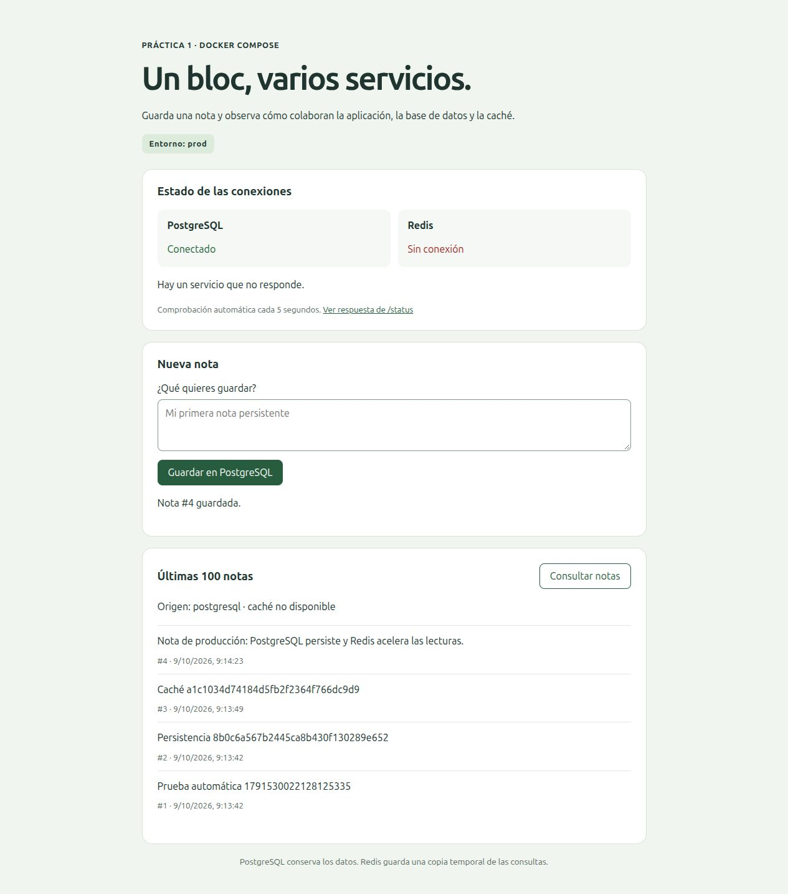
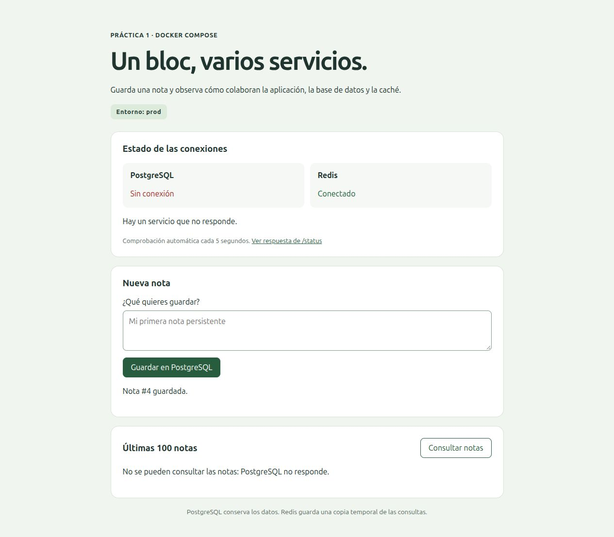

# Resultados y evidencias

Las evidencias se separan por fecha. Las capturas del 9 de octubre documentan aquella versión de la interfaz; los registros del 14 de octubre corresponden a la revisión de entrega, incluida la salida JSON en ASCII. Un registro describe una ejecución concreta, no garantiza el estado futuro de los contenedores.

## Verificación de entrega: 14 de octubre de 2026

| Comprobación | Evidencia de desarrollo | Evidencia de producción |
| --- | --- | --- |
| Construcción y arranque con healthchecks | [Arranque dev](evidencias/2026-10-14/arranque-dev.txt) | [Arranque prod](evidencias/2026-10-14/arranque-prod.txt) |
| Pruebas unitarias dentro de Docker | [Unitarias dev](evidencias/2026-10-14/unitarias-dev.txt) | [Unitarias prod](evidencias/2026-10-14/unitarias-prod.txt) |
| Conexión SQL con el usuario de la aplicación | [SQL dev](evidencias/2026-10-14/sql-dev.txt) | [SQL prod](evidencias/2026-10-14/sql-prod.txt) |
| API: creación y lectura de notas | [HTTP dev](evidencias/2026-10-14/http-dev.txt) | [HTTP prod y caché](evidencias/2026-10-14/http-prod.txt) |
| Persistencia y caídas reales | [Integración dev](evidencias/2026-10-14/integracion-dev.txt) | [Integración prod](evidencias/2026-10-14/integracion-prod.txt) |
| Estado al finalizar | [Estado dev](evidencias/2026-10-14/estado-dev.txt) | [Estado prod](evidencias/2026-10-14/estado-prod.txt) |

La suite contiene 14 pruebas unitarias. Simulan las dependencias para comprobar caché, errores, validación, inserción parametrizada y confirmación antes de invalidar Redis. La prueba de ASCII comprueba respuestas desde PostgreSQL y Redis y verifica que los textos originales se conservan en los datos que se escriben.

Las pruebas HTTP e integración usan contenedores reales. La persistencia se comprueba directamente por SQL después de eliminar y recrear el contenedor de PostgreSQL conservando el volumen. En producción se comprueban MISS/HIT, caída de Redis y lectura alternativa desde PostgreSQL. Estas pruebas crean notas y provocan interrupciones temporales.

### Evidencia obtenida directamente de Redis

El archivo [redis-contadores.txt](evidencias/2026-10-14/redis-contadores.txt) registra los contadores de `redis-cli INFO stats` antes y después de dos peticiones HTTP consecutivas. Contrasta el incremento de `keyspace_hits` con la respuesta de Flask y comprueba que el contenido de las notas devuelto es ASCII.

Los contadores proceden de Redis, no del JSON de Flask. Son globales de la instancia: si otros clientes consultan claves a la vez, sus operaciones también cuentan. `Cache-Control: no-store` no afecta a esta caché interna; se refiere a cachés HTTP de clientes e intermediarios.

## Evidencias históricas: 9 de octubre de 2026

Se conservan para documentar la primera verificación, sin presentarlas como resultados actuales:

- [SQL dev](evidencias/2026-10-09/sql-dev.txt) y [SQL prod](evidencias/2026-10-09/sql-prod.txt).
- [HTTP dev](evidencias/2026-10-09/http-dev.txt) y [HTTP prod](evidencias/2026-10-09/http-prod.txt).
- [Integración dev](evidencias/2026-10-09/integracion-dev.txt) e [integración prod](evidencias/2026-10-09/integracion-prod.txt).
- [13 pruebas unitarias de aquella versión](evidencias/2026-10-09/unitarias-docker.txt).
- [Auditoría de redes, puertos, volúmenes, permisos y aislamiento](evidencias/2026-10-09/auditoria.txt).

La auditoría registró solo puertos web publicados, redes backend internas, volúmenes separados y web con UID 10001. El rol SQL de la aplicación permitía SELECT e INSERT, sin superusuario ni permiso DELETE. Las versiones observadas constan en esa salida histórica; las etiquetas de las imágenes pueden obtener nuevas revisiones al reconstruir.

### Desarrollo: PostgreSQL conectado y Redis no configurado



### Producción: lectura indicada como Redis por la aplicación



### Redis detenido: lectura alternativa desde PostgreSQL



### PostgreSQL detenido: error de lectura sin copia disponible



### Recuperación de los servicios


Una captura fija muestra el estado visible en ese momento; por sí sola no demuestra el paso del tiempo ni la actualización automática. Los registros de integración complementan estas capturas.

## Cómo repetir las pruebas

Desde la raíz del proyecto, con Docker disponible y sin otras consultas concurrentes:

```bash
./run.sh init
./run.sh up-dev
./run.sh up-prod
./run.sh unit dev
./run.sh unit prod
./run.sh test dev
./run.sh verify dev
./run.sh test prod
./run.sh verify prod
./run.sh status dev
./run.sh status prod
```

El procedimiento de presentación y la eliminación opcional de datos se explican en el [guion de presentación del README](../README.md#presentacio). Los registros de esta carpeta no acreditan publicación en GitHub ni entrega en el campus.
